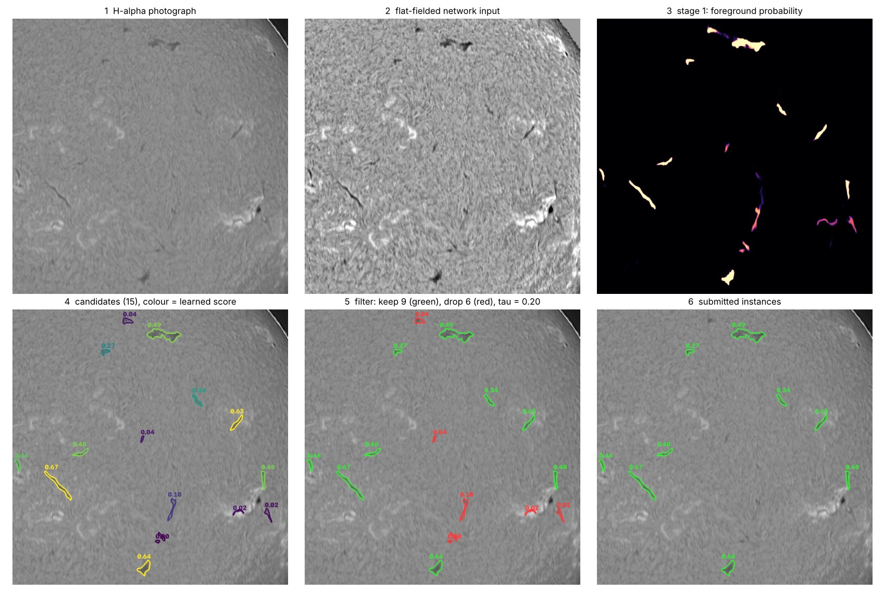
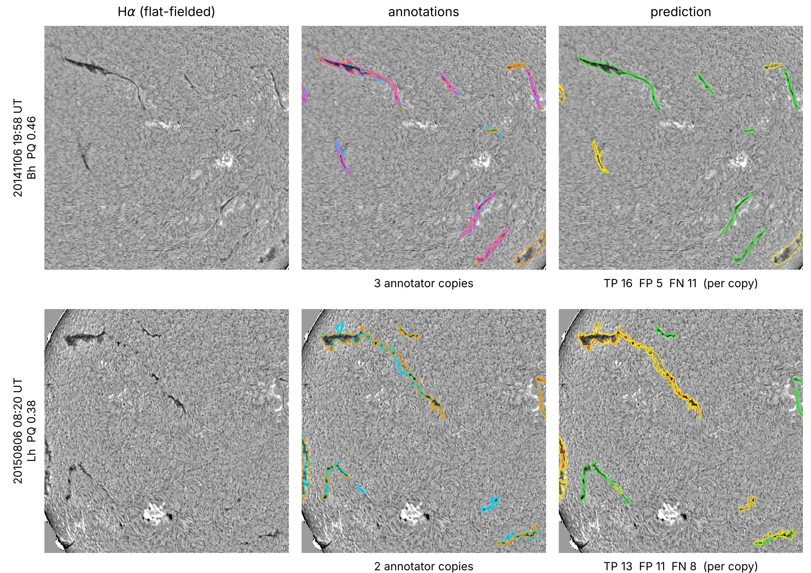
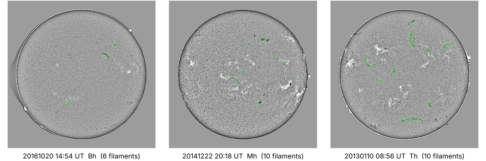
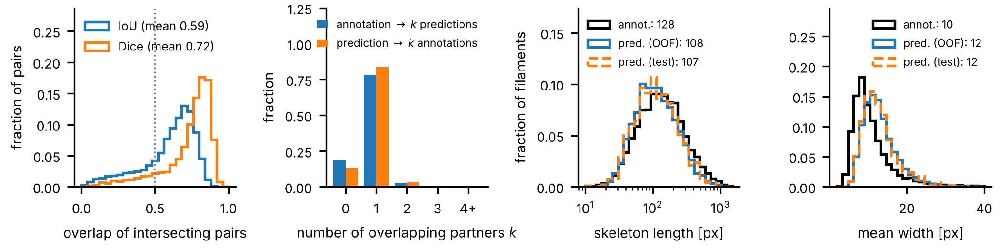

# Solar filament instance segmentation - Filament Segmentation Challenge 2026

Pipeline for the Kaggle competition *Solar Filament Segmentation Challenge 2026*
([`filament-segmentation-2026`](https://www.kaggle.com/competitions/filament-segmentation-2026)): instance
segmentation of solar filaments in GONG H-alpha full-disk observations (MAGFiLO dataset), optimised for the competition's
Panoptic Quality (PQ) metric. Author: Doğukan Turan.

The method in one paragraph: ten U-Nets (EfficientNet-B4 encoder, five folds grouped by observation day, two input
resolutions) trained on the *soft consensus* of the annotators give a foreground and an instance-border probability map;
connected components of the thresholded map (with short gaps closed) are filament *candidates*; a gradient-boosted model,
fitted on out-of-fold candidates, predicts each candidate's expected contribution to PQ and the candidates above a single
threshold are submitted. The 4-page report is submitted separately through the competition form.

## Results

Every number is computed on **out-of-fold (OOF)** predictions: a photograph is only ever predicted by networks that did not
see it, and every component after the networks (candidate filter, thresholds) is fitted on OOF predictions as well.
707 annotated photographs, 8199 annotated filaments, five folds grouped by observation day. Intervals are 95 % percentile
bootstrap intervals that resample observation days (photographs of one day are near-duplicates).

| post-processing of the stage-1 maps | PQ [95 % CI] | SQ | DQ |
|---|---|---|---|
| threshold 0.5, connected components | 0.396 [0.386, 0.404] | 0.678 | 0.584 |
| + fragment linking (14 px) | 0.407 [0.398, 0.416] | 0.677 | 0.602 |
| + hand-tuned area / score filter | 0.442 [0.432, 0.451] | 0.682 | 0.648 |
| **+ learned instance filter (final)** | **0.450 [0.440, 0.459]** | 0.680 | 0.661 |
| *annotator vs. annotator (same photograph)* | *0.340* | *0.634* | *0.536* |

* The learned filter improves on the best hand-tuned rule (grid-searched on the same OOF candidates, i.e. optimistic for
  the rule) by +0.008 PQ, paired-bootstrap interval [+0.005, +0.011]. It halves the false positives (4705 -> 2403) for a loss
  of 6 % of the true positives. PQ per fold: 0.423 ... 0.462.
* Rubric measures on the OOF predictions: semantic Dice of the union masks 0.680 [0.670, 0.690]; mean Dice / IoU of
  intersecting prediction-annotation pairs 0.72 / 0.59; 84 % of the predictions overlap exactly one annotation and 3 %
  two or more (one-to-many / many-to-one overlaps are rare, the errors are errors of extent, not of splitting or merging).
* The annotators' own disagreement caps what any single prediction can reach: two annotators of the same photograph reach
  PQ 0.34 against each other, whereas our consensus prediction reaches 0.448 against each of the annotators of the 296
  photographs that have several (the consensus target is closer to every annotator than the annotators are to each other).
* Public leaderboard: the previous version of this pipeline (hand-tuned filter instead of the learned one) scored 0.38,
  i.e. 0.87 x its OOF PQ. The OOF PQ is optimistic: the best epoch of every network is selected on its held-out fold.

### Examples



*One test photograph, stage by stage (`solarfil.visualize.pipeline_figure`): H-alpha image, flat-fielded network input,
stage-1 foreground probability, candidate instances coloured by the learned score g_hat, the filter's decision
(tau = 0.20) and the submitted instances.*



*Out-of-fold examples (`python -m solarfil.figures oof`) at the median and 25th percentile of per-photograph PQ. Columns:
photograph, annotator copies (cyan / orange / magenta), prediction (green = matched at IoU > 0.5, red = unmatched
prediction, yellow = annotation without a match).*



*Predictions on three test photographs (`python -m solarfil.figures test`; no ground truth exists for them).*



*Overlap and morphology statistics of 8199 annotated and 4688 predicted filaments.*

## Method

| Stage | Module | What and why |
|---|---|---|
| Pre-processing | `preprocess.py` | 3 channels: percentile-normalised intensity; *flat-field* image (intensity divided by a smooth background estimated inside the Otsu-detected disk from a median-filtered copy, sigma = 24 px); CLAHE of the flat-field image. Removes limb darkening and site-to-site gradients. |
| Targets | `annotations.py` | Polygons rasterised at 2048^2 and averaged over all annotator copies of a photograph (**soft consensus**, because the metric scores a prediction against *every* copy and the copies disagree); plus an instance-border map (pixels where the 5-px dilations of two different filaments of one annotator meet). |
| Stage 1 network | `model.py`, `train.py` | U-Net, ImageNet-pretrained EfficientNet-B4 encoder, scSE decoder attention (`segmentation_models_pytorch`), two outputs (foreground, border). BCE (positive weight 3) + soft Dice, plus 0.5 x (BCE + 0.5 Dice) on the border. 768^2 crops of the photograph resized to 1536^2 or 2048^2 (70 % centred on a filament), dihedral + photometric augmentation, AdamW (lr 6e-4, cosine), 36 / 32 epochs (1536^2 / 2048^2), batch 6, mixed precision, EMA 0.998 of the weights; the epoch with the best held-out PQ is kept. Five folds **grouped by observation day**, so near-duplicate photographs of one day never straddle folds. |
| Inference | `infer.py`, `model.py` | Whole photograph, 8 dihedral transforms, ensemble of the 10 networks (5 folds x 2 resolutions), probabilities averaged at 2048^2: 80 forward passes per photograph. |
| Candidates | `postprocess.py` | Foreground threshold 0.5, components < 40 px removed, fragments closer than 14 px linked (dilation of radius 7), at least 100 px; about 8 candidates per photograph (more than are annotated). Masks are disjoint by construction, as the submission format requires. The border map is trained, but cutting along it did not improve OOF PQ and is switched off. |
| Learned instance filter | `rescore.py` | 36 features per candidate (probability statistics inside it, shape: area / skeleton length / width / solidity / orientation, position, contrast against a 12-px ring, context: neighbours, rank of its confidence, photograph-level activity). A histogram gradient-boosting regressor predicts the candidate's **expected PQ gain** g = mean over annotator copies of IoU x [IoU > 0.5]. Adding a candidate changes the PQ denominator TP + FP/2 + FN/2 by exactly +1/2 (match: TP+1, FN-1; no match: FP+1) and the numerator by its IoU, so it improves PQ iff g > PQ/2 ~ 0.22; we keep candidates with g_hat >= 0.20 (PQ is flat for thresholds in [0.18, 0.26]). Fitted on OOF candidates only; the stored file holds the training table, not a pickled model, so it does not depend on the scikit-learn version. |
| Evaluation | `metric.py`, `evaluate.py`, `morphology.py` | Re-implementation of the official PQ (pooled over annotator copies, IoU > 0.5) and of the rubric measures (Dice, IoU, one-to-many / many-to-one), day-level bootstrap intervals, skeleton length / width statistics. |
| Visualisation | `visualize.py`, `figures.py` | H-alpha overlays, a step-by-step figure of one photograph, report figures. |
| Stage 2 (experimental) | `refine.py`, `cands.py` | Instance-conditioned re-segmentation of every selected candidate in its own rotated crop (code and training protocol only; see the docstring). |

Compliance: only the competition's training photographs and annotations are used to fit anything (ImageNet initialisation
of the encoders aside); the only input at test time is the test H-alpha photograph itself - no metadata, no neighbouring
frames, no external or leaked labels, no annotations of the public test set.

## Repository layout

```
pipeline.ipynb       notebook that runs the whole pipeline (reproduce the submission / retrain everything)
solarfil/            the package (modules above, one responsibility each; every module has a docstring with its CLI)
configs/
  weights.json       manifest of the 10 checkpoints (URL inside this repository + SHA-256)
  rescorer_all.npz   training table of the learned instance filter + threshold + candidate settings
  postcfg.json       candidate settings and hand-tuned filter of the baseline row of the table
weights/             the 10 trained U-Nets (82 MB each, ImageNet-pretrained EfficientNet-B4 U-Net, EMA weights)
tests/               unit tests (metric, post-processing, re-scorer, evaluation, stage-2 geometry)
docs/                figures
requirements.txt     versions used for the submitted results (Kaggle notebook image, Python 3.13)
```

## Reproduce the submission

Open `pipeline.ipynb` (GPU) and run all cells with `RUN_MODE = "REPRODUCE_SUBMISSION"` (the default). The weights are in
`weights/`; a missing or corrupted file is fetched from the URL of `configs/weights.json` and verified against its SHA-256.
Prediction of the 180 test photographs takes about one hour on a T4 / P100; set `QUICK = True` to process only six
photographs (a few minutes) as an environment check. The notebook writes `submission.csv` and figures.

Command line equivalent:

```bash
pip install -r requirements.txt
DATA=/path/to/MAGFiLO_1.0_Kaggle_2026            # contains train/ and test/
python -m solarfil.weights --manifest configs/weights.json --dest weights
python -m solarfil.infer --data_root $DATA --ckpts weights/*.pth --rescorer configs/rescorer_all.npz \
       --save_probs work/probs --out submission.csv
python -m solarfil.infer --from_probs work/probs --rescorer configs/rescorer_all.npz --out submission.csv   # CPU: only the post-processing
```

GPU arithmetic in half precision is not bit-wise deterministic: re-running may move a few boundary pixels, not the
filaments. The learned filter is re-fitted from `configs/rescorer_all.npz` in a few seconds on every run (it is
deterministic).

## Retrain everything (`RUN_MODE = "TRAIN_FULL"`, 20+ GPU hours)

```bash
for f in 0 1 2 3 4; do python -m solarfil.train --data_root $DATA --work work --fold $f --size 1536 --epochs 36; done
for f in 0 1 2 3 4; do python -m solarfil.train --data_root $DATA --work work --fold $f --size 2048 --epochs 32; done
# out-of-fold maps are written to work/oof_Unet_efficientnet-b4_s{1536,2048}; fit the learned filter on them
python -m solarfil.rescore --data_root $DATA --postcfg configs/postcfg.json --gt all=1,2,3,4 --thr 0.20 \
       --view work/oof_Unet_efficientnet-b4_s1536 \
       --view work/oof_Unet_efficientnet-b4_s1536,work/oof_Unet_efficientnet-b4_s2048 --out work/rescorer_{name}.npz
python -m solarfil.infer --data_root $DATA --ckpts work/Unet_*.pth --rescorer work/rescorer_all.npz --out submission.csv
```

`--thr 0.20` fixes the filter threshold to the centre of the PQ plateau (without it the PQ-optimal point of the
cross-validation sweep is taken, 0.24 in our run).

## Evaluate any prediction file

```bash
python -m solarfil.annotations --data_root $DATA --out gt_train.csv         # ground truth in the submission format
python -m solarfil.evaluate --gt gt_train.csv --pred my_predictions.csv --bootstrap 1000 --plots figures
```

prints PQ / SQ / DQ, the semantic Dice, mean Dice and IoU of overlapping pairs, the one-to-many and many-to-one
distributions and bootstrap intervals, and writes the Dice / IoU histograms. `gt_train.csv` ids are
`<annotator>-<photo>_<k>`; every annotator copy is scored separately, exactly like the competition metric.

## Notes on the data

* 707 training photographs (2011-2022, six GONG sites), 1154 annotator copies (1-3 per photograph), 8199 filaments, each
  a single polygon; median filament area about 1200 px at 2048^2. 180 test photographs.
* Annotators disagree strongly (PQ 0.34 between two annotators), which is why the learned consensus is a better target than
  any single annotator's labels.

## Tests

```bash
python -m pytest -q tests
```

## License

MIT, see `LICENSE`. The GONG data belong to NSO/AURA and are used under the competition's terms; they are not part of this
repository.
